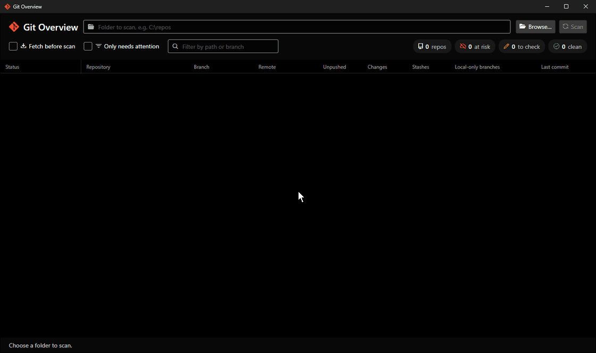

# Git Overview

Find work that exists only on your machine, across every git repository in a folder.



Flags repos with no remote, unpushed commits, uncommitted changes, stashes or branches without upstream.
Read-only: it never changes your repositories or git config.

## Run

Requires the .NET 10 SDK and git.

```
dotnet run -- C:\path\to\repos
```

Built with [Avalonia](https://avaloniaui.net). Icons: [Symbols Nerd Font](https://www.nerdfonts.com) (MIT).
